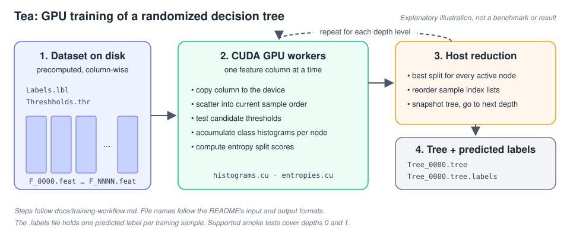

# Tea

[](TreeBuilder.cu)
[](CMakeLists.txt)
[](CMakeLists.txt)

Tea trains a randomized decision tree from precomputed feature columns. CUDA workers accumulate
class histograms and score candidate splits; the host selects splits, reorders sample indices
and writes tree snapshots and predicted labels. The related BMVC 2015 paper [*Rule of Thumb: Deep Derotation for Improved Fingertip Detection*](https://arxiv.org/abs/1507.05726)
is by Aaron Wetzler, Ron Slossberg and Ron Kimmel. This repository includes tools for converting
that work's HandNet data into Tea feature columns.



*Implementation schematic. It contains no measured throughput or accuracy result.*

## Current implementation

The source uses C++ standard-library threading, Make and CMake build paths, and Python tools for
data generation, inspection, expansion, HandNet conversion and bounded synthetic benchmark runs.
These are implemented workflows, not a claim that all historical configurations have been validated.
The automated training checks are limited to two small synthetic cases at depths 0 and 1; the
separate converter check exercises the HandNet-to-Tea data path on four synthetic MAT frames,
not the original dataset archives.

Tea reads a directory containing:

- `Labels.lbl`: one binary `uint16` class ID per sample.
- `Threshholds.thr`: three binary `float32` threshold metadata values per feature. The spelling is
  part of the file format.
- `F_0000.feat`, `F_0001.feat`, …: one binary feature column per file, with datatype selected by the CLI.

A run writes `Tree_0000.tree`, `Tree_0000.tree.labels` and `LogFile_<prefix>_0000.log` to the dataset
directory for tree number 0. Snapshots are rewritten as training advances through the depths.
See [dataset format](docs/dataset-format.md) and [CLI/output details](docs/cli-and-outputs.md).

## Requirements and first run

The documented training target is Linux with an NVIDIA GPU with a working driver, the CUDA toolkit (`nvcc`) and a
C++11-capable host compiler. Python 3 drives the tests and data tools; CMake is optional. OpenMP
can be disabled. HandNet conversion additionally requires NumPy and SciPy, and `bsdtar` for RAR
input. This is not a CPU-only trainer.

```bash
bash scripts/check_env.sh
make Tea
make smoke
```

The Makefile defaults to `CUDA_ARCH=sm_86`; select the architecture for the installed GPU and
compiler, for example `make Tea CUDA_ARCH=sm_89`. Use `make Tea OPENMP_FLAGS=` to disable OpenMP.
The CMake alternative is `bash scripts/build.sh`, followed by
`python3 tests/run_smoke_tests.py --tea ./build-cmake/Tea`.

To generate and train a tiny root-only example (argument order is documented in
[CLI/output details](docs/cli-and-outputs.md)):

```bash
python3 tests/gen_smoke_dataset.py /tmp/tea-example-root --scenario root
./Tea 4 4 0 0 F_FLOAT 16 4 0 0 W_ONES /tmp/tea-example-root/ example_root 0 LOG1 "manual root example"
```

See [getting started](docs/getting-started.md) for compiler overrides and documentation setup,
[examples](examples/README.md) for CLI cases, [HandNet conversion](docs/handnet.md) for archive
preprocessing, and [benchmarking](docs/benchmarking.md) for CSV-producing synthetic sweeps.

## Validation scope

Review date: 2026-11-12.

[tests/run_smoke_tests.py](tests/run_smoke_tests.py) defines two cases: `root-depth0` and
`depth1-balanced`. Both use generated `F_FLOAT` features, unit sample weights, GPU 0 and equal
maximum/folding depths. The runner checks process exit, nonempty tree/label/log outputs, exact
training-label predictions and a `Depth X: 100.0000%` log line. That percentage is training-set
self-success for a deliberately separable synthetic dataset, not held-out accuracy.

`make handnet-smoke` runs [tests/run_handnet_converter_test.py](tests/run_handnet_converter_test.py).
It creates four synthetic MAT frames, converts them to 1,024 samples and 40 `F_CHAR` features,
checks file sizes and labels 0–6, estimates memory under a configured 500 MB cap, then runs a
depth-1 tree and checks for nonempty outputs. It does **not** compare its predicted labels with
expected labels. Coverage consists of two training cases and one conversion scenario; it does not
include an application benchmark or broad regression coverage.

This documentation revision reviewed the implementation and test assertions and rebuilt the
documentation. It did not compile CUDA, run the GPU tests, start training or reproduce the paper's
results. The repository does not include raw logs for a current toolchain validation. Historical
run descriptions in the guides are identified as reports rather than newly verified results.

## Limitations

The small tests do not cover deep trees, all feature types, alternate weighting modes, multiple
GPUs or application-level accuracy. Features must be prepared before training; the core trainer
does not extract image features. Synthetic benchmark timing and training-set self-success do not
measure HandNet fingertip detection accuracy. Pixel-label imbalance can make that self-success
high even when a model predicts the dominant class.

Before a large run, inspect the input format and estimate memory using the linked tools. The
memory cap is an estimate, not a guarantee that all runtime allocations fit. Further work is
needed for held-out prediction/evaluation and deeper regression cases.

## Documentation and attribution

The [MkDocs source](docs/index.md) describes the operator chain and workflows. Build it with
`bash scripts/build_docs.sh` after installing `requirements-docs.txt`; the existing GitHub Pages
workflow is configured to publish it. See [site maintenance](docs/docs-site.md) for details.

Existing author credits and source notices are retained. No standalone software license is
included in this checkout; these documentation changes do not assign one.
